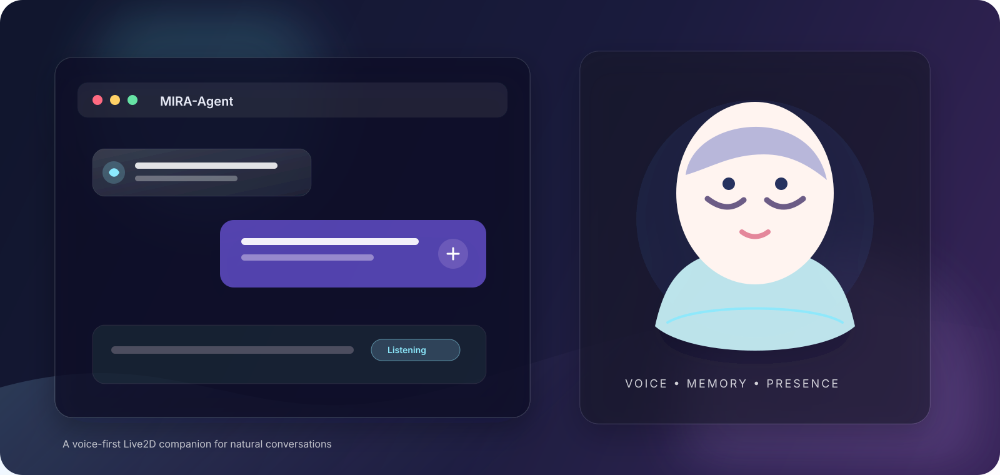

<div align="center">

# MIRA-Agent

**一个可以看、可以听、可以对话的 Live2D 智能伙伴**

用文字或语音和角色自然交流，让 AI 回答、声音和表情保持在同一个对话里。

[](https://www.python.org/)
[](https://nodejs.org/)
[](https://react.dev/)
[](https://fastapi.tiangolo.com/)

</div>

<p align="center">
  
</p>

## MIRA-Agent 是什么

MIRA-Agent 是一个面向个人使用的桌面式 AI 角色应用。它把对话、语音、Live2D 角色和轻量的个人助理能力放在一个浏览器界面中：你可以直接输入文字，也可以打开麦克风和角色说话。

它适合用来体验自己的模型、声音和角色，也适合作为构建 AI 角色产品的起点。

## 功能

- **文字对话**：支持流式回复、逐句字幕，以及中途停止和继续生成。
- **语音交互**：麦克风输入、自动识别、语音回复；设备支持时可以边播放边插话。
- **Live2D 角色**：角色会根据回复播放声音、表情、视线和动作。
- **自然的控制方式**：支持“停止”“继续”“重复一遍”“换个话题”等常用口令。
- **记忆与偏好**：可以记住经过确认的个人偏好，并随时查询、更正或删除。
- **提醒事项**：创建一次性提醒，到期后在页面中通知；重新连接后可补发离线期间的提醒。
- **时间与天气**：查询当前时间、日期和天气，也可以把多个查询组合成一个任务。
- **参数工作台**：调整角色参数和语义映射，并在浏览器中保存或导出配置。

## 快速开始

### 1. 准备环境

| 环境 | 版本或要求 |
| --- | --- |
| Python | 3.11 或更高版本 |
| Node.js | 22 或更高版本 |
| 浏览器 | 支持 Web Audio、AudioWorklet 和 WebSocket，并允许麦克风访问 |
| AI 服务 | 至少准备一个兼容 Chat Completions 的 LLM 接口 |

语音输入还需要 ASR 服务和 Silero VAD 模型；语音回复需要 TTS 服务。只想先体验文字对话时，可以暂时跳过语音配置。

### 2. 安装后端

以下命令以 PowerShell 为例：

```powershell
cd backend
conda env create -f environment.yml
conda activate mira-agent
python -m pip install -e .
Copy-Item .env.example .env
```

没有 Conda 时，也可以使用 Python 3.11+ 创建虚拟环境，再执行 `python -m pip install -e .`。

### 3. 安装前端

在另一个终端中执行：

```powershell
cd frontend
npm ci
```

### 4. 配置模型服务

编辑 `backend/.env`，至少填写 LLM 配置：

```dotenv
MIRA_LLM_URL=https://your-provider.example/v1/chat/completions
MIRA_LLM_KEY=your-api-key
MIRA_LLM_MODEL_NAME=your-model-name
```

如果要启用语音，再填写 ASR 和 TTS：

```dotenv
MIRA_ASR_URL=https://your-provider.example/v1/audio/transcriptions
MIRA_ASR_KEY=your-asr-key
MIRA_ASR_MODEL_NAME=your-asr-model

MIRA_TTS_URL=https://your-provider.example/v1/audio/speech
MIRA_TTS_KEY=your-tts-key
MIRA_TTS_MODEL_NAME=your-tts-model
MIRA_TTS_VOICE=your-voice-id
```

密钥只需要放在后端 `.env` 中，不要写入前端代码或提交到 Git。

### 5. 启动应用

启动后端：

```powershell
cd backend
conda activate mira-agent
python -m uvicorn src.main:app --host 127.0.0.1 --port 8000 --reload
```

启动前端：

```powershell
cd frontend
npm run dev
```

打开终端中显示的地址，通常是 [http://localhost:5173](http://localhost:5173)。

## 本地资源

只有在使用语音或 Live2D 时才需要额外准备资源：

- **语音输入**：下载 [Silero VAD 模型](https://github.com/snakers4/silero-vad/blob/master/src/silero_vad/data/silero_vad_16k_op15.onnx)，放到 `backend/model/silero_vad_16k_op15.onnx`。
- **Live2D 渲染**：从 [Cubism SDK for Web](https://www.live2d.com/en/sdk/download/web/) 获取 `live2dcubismcore.min.js`，并按其许可条款使用。
- **角色模型**：准备自己拥有使用权的 Cubism 模型，并放入 `frontend/public/models/`。模型文件需要保持原有的相对目录结构。

## 使用方法

打开页面后，可以直接从文字对话开始：

1. 在输入框中输入问题，按 Enter 或点击发送。
2. 点击麦克风按钮开始语音交互；说完后会自动提交。
3. 回复过程中可以点击“停止”，或直接说“停一下”。
4. 想接着刚才的话题继续时，说“继续”；想重新表达时，说“重复一遍”。
5. 试试下面这些例子：

```text
记住：我喜欢简短回答
你记得我的回答风格吗？
十分钟后提醒我休息
查杭州明天的天气
查询 UTC 当前时间，并换算成上海时间
```

首次播放声音时，浏览器可能会要求先点击页面。麦克风功能需要授予浏览器访问权限；远程部署时请使用 HTTPS。

## 常用配置

这些选项可以直接写在 `backend/.env` 中：

| 配置 | 默认值 | 用途 |
| --- | --- | --- |
| `MIRA_DEFAULT_TIMEZONE` | `Asia/Shanghai` | 时间、提醒和日期计算使用的时区 |
| `MIRA_MEMORY_ENABLED` | `true` | 是否启用长期记忆 |
| `MIRA_REMINDERS_ENABLED` | `true` | 是否启用提醒事项 |
| `MIRA_WEATHER_ENABLED` | `true` | 是否启用天气查询 |
| `MIRA_FULL_DUPLEX_ENABLED` | `true` | 是否允许播放时继续监听麦克风 |

天气查询使用 Open-Meteo，无需额外的 API Key。想关闭持续监听时，将 `MIRA_FULL_DUPLEX_ENABLED` 改为 `false` 并重启后端即可。

## 常见问题

**页面显示“Agent 未连接”**

确认后端正在运行，并检查前端代理使用的端口是否仍为 `8000`。

**语音按钮不可用**

检查 ASR 配置、VAD 模型文件和浏览器麦克风权限；只配置 LLM 时，文字对话仍然可以正常使用。

**有字幕但没有声音**

检查 TTS 配置、音色 ID 和浏览器播放权限。首次播放通常需要用户点击页面。

**角色不显示或动作异常**

检查 Cubism Core、模型文件和模型目录是否完整，并确认模型文件来自合法授权来源。

**想换一个角色**

将新的 Cubism 模型放入 `frontend/public/models/`，再根据模型的参数调整映射文件。不同模型的参数名称和范围可能不同。

## 项目边界

当前版本聚焦于文字和语音对话、Live2D 表现、记忆、提醒以及基础的时间天气工具；视觉输入、MCP 接入和账户登录暂未提供。

## 目录说明

```text
backend/   后端服务与模型接口配置
frontend/  浏览器界面、音频交互与 Live2D 角色
shared/    前后端共用的数据格式
docs/      项目文档与展示资源
```

如果你准备扩展新的模型服务、声音或角色，可以先从 `.env.example` 和现有资源目录开始。

